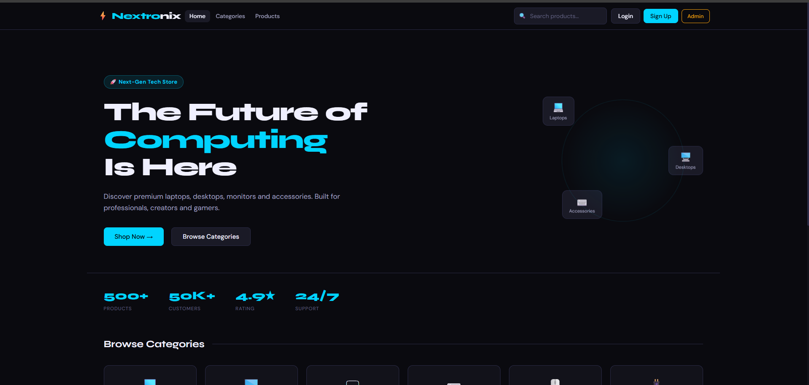
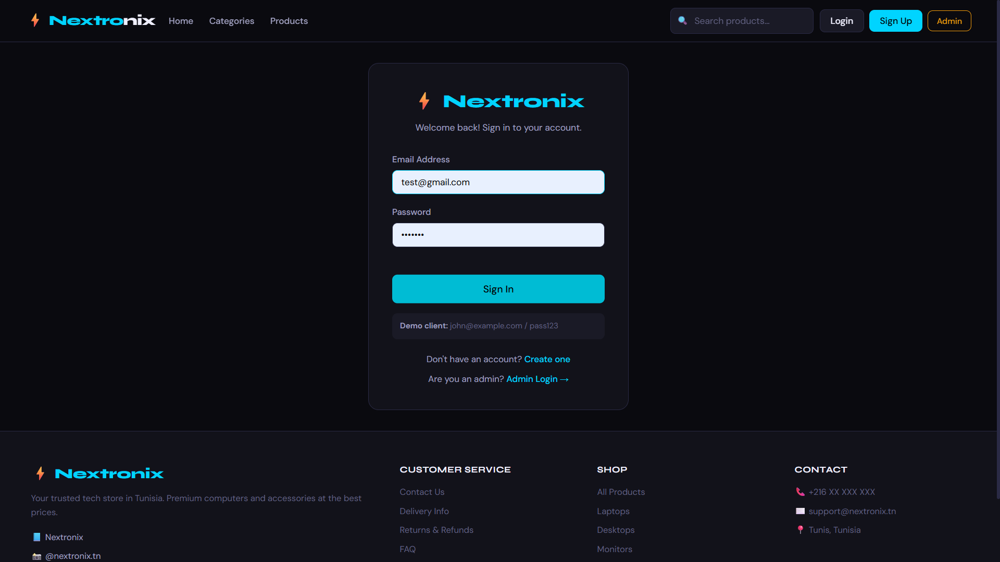
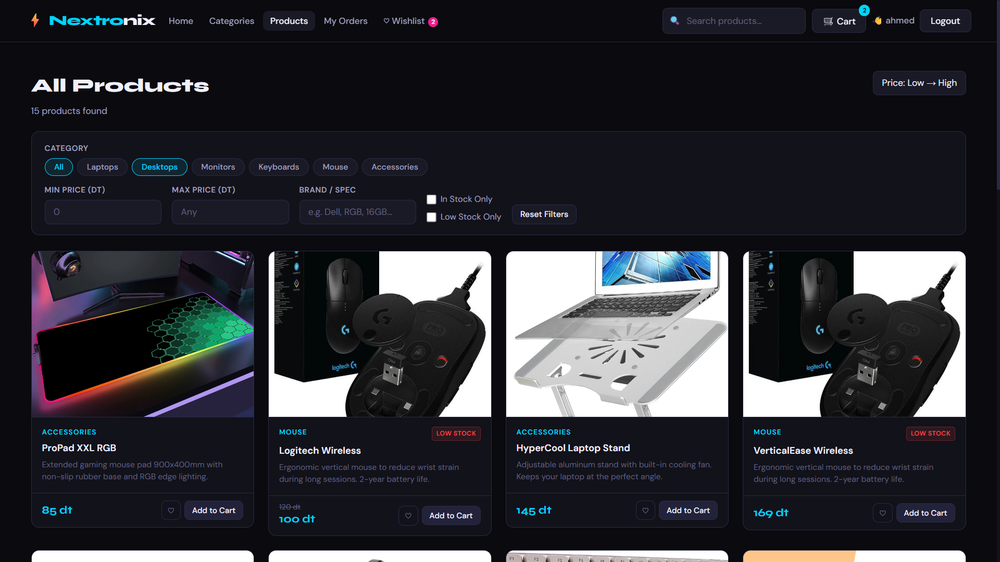
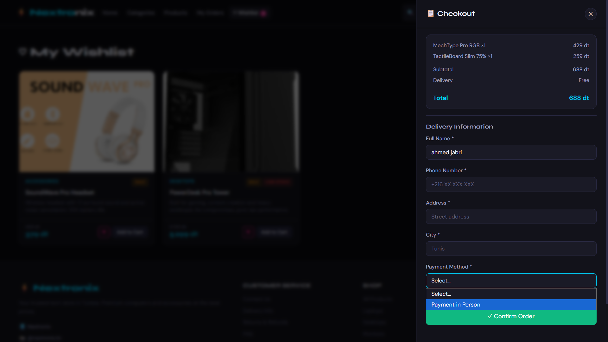
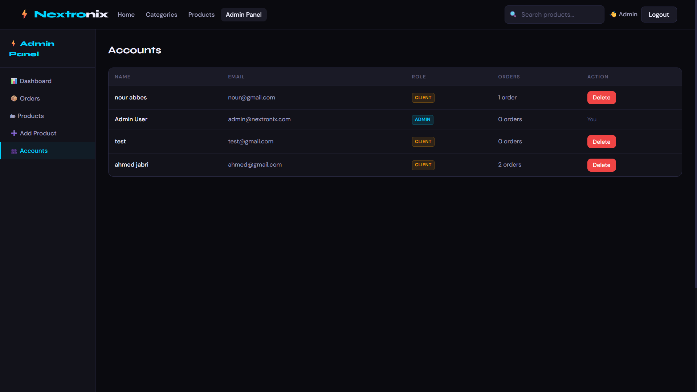

# Nextronix

A full-stack electronics e-commerce application developed as a university team project at ISAMM.

Nextronix includes client and admin authentication, product browsing and search, shopping cart and wishlist functionality, order placement, and an administrative dashboard.



## Features

- Client registration and login
- Separate administrator login
- Product catalog with category and text-based filtering
- Product specifications and stock information
- LocalStorage-backed carts and wishlists
- Checkout with delivery fees
- Client order history
- Admin product, order, account, and stock management
- MySQL-backed product and order data
- PHP backend endpoints for authentication, catalog, orders, and users

## Technologies

- HTML5
- CSS3
- Vanilla JavaScript
- PHP
- MySQL
- PHP sessions
- Git and GitHub
- XAMPP or WAMP for local development

## Project Structure

```text
.
├── index.html
├── app.js
├── style.css
├── backend/
│   ├── auth.php
│   ├── config.php
│   ├── db.php
│   ├── health.php
│   ├── orders.php
│   ├── products.php
│   ├── schema.sql
│   ├── seed_products.php
│   └── users.php
├── conception/
├── screenshots/
└── README.md
```

## Screenshots

### Login and Registration



### Product Catalog



### Shopping Cart



### Admin Panel



## Database

The MySQL schema defines:

- `users` — client and administrator accounts
- `products` — catalog data, stock, pricing, and specifications
- `orders` — checkout totals and order status
- `order_items` — products included in each order

Passwords are stored as PHP password hashes. See `backend/schema.sql` for the complete schema.

## Running Locally

### Requirements

- MySQL
- PHP with PDO MySQL support
- Git
- XAMPP or WAMP can be used to provide MySQL and, optionally, Apache

### Setup

1. Clone the repository:

   ```bash
   git clone https://github.com/Nour-Abbes/e-commerce-uni-project.git
   cd e-commerce-uni-project
   ```

2. Start MySQL. If using XAMPP or WAMP, start MySQL from its control panel. Apache is only needed if you choose to serve the application through Apache.

3. Import `backend/schema.sql` through phpMyAdmin or the MySQL CLI. The script creates and selects the `nextronix` database.

4. If needed, update the database credentials in `backend/config.php`.

5. Serve the application using one of these options:

   **PHP's built-in server:**

   ```bash
   php -S localhost:8000
   ```

   Open `http://localhost:8000`.

   **Apache through XAMPP or WAMP:**

   Place the repository in the server's web root, start Apache, and open the corresponding local project URL, such as `http://localhost/e-commerce-uni-project/`.

The backend health endpoint is available at `/backend/health.php`. For the built-in server, use `http://localhost:8000/backend/health.php`.

### Optional Product Seed

To populate the database with the sample catalog, open `/backend/seed_products.php` in the running application. For the built-in server, use:

```text
http://localhost:8000/backend/seed_products.php
```

The seed script skips products that already exist and can be run repeatedly without duplicating those entries.

## Accounts

New users can register as clients.

An account must already exist with the `admin` role in the `users` table to access the administrator panel. The repository does not include a database seed for an administrator account.

## Repository

Maintained by [Nour Abbes](https://github.com/Nour-Abbes).